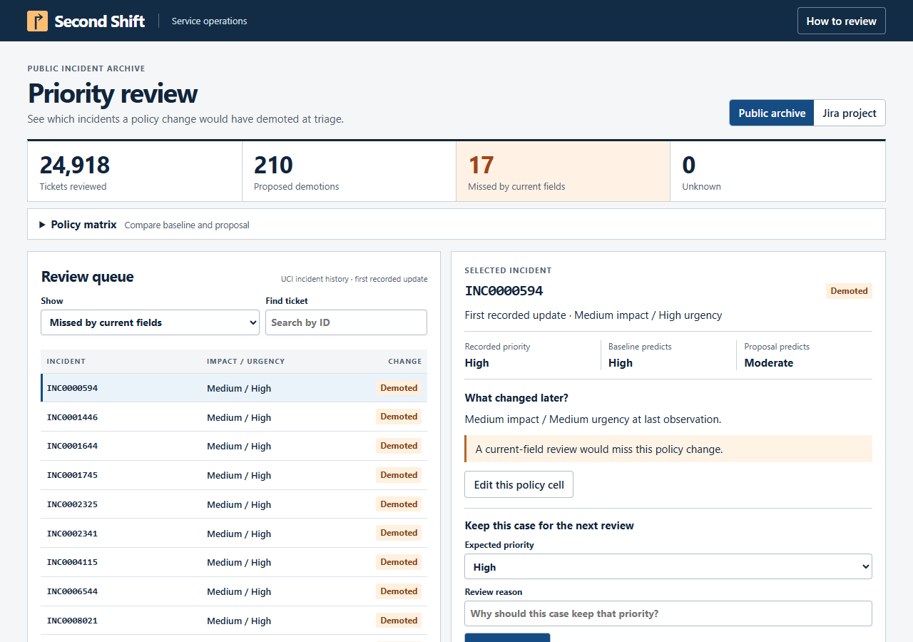

# Second Shift

Rehearse an incident priority policy against the evidence available at triage. A support lead can see which tickets would move, inspect the field edits behind each result, and save an expected priority for the next review.

**[Try the public review](https://kathir-itech.github.io/second-shift/)** · [Judge walkthrough](JUDGES.md) · [Codegeist 2026](https://codegeist2026.devpost.com/)



## Try one decision

Open the public review and select **INC0000594**. Its first observed urgency was High and its last was Medium. The example policy edit affects only Medium-impact, High-urgency incidents. See how the same ticket disappears from a review based on its latest fields. Save High as its expected priority, enter your reason, and select **Edit this policy cell**. Change the proposal to High. The saved test should now pass.

## Inside Jira

Second Shift runs as a Forge Custom UI Jira project page. The resolver reads fields, statuses, priorities, permitted tickets and changelogs as the signed-in user. Select the first transition into a project-specific triage status. The engine walks later changes backward to reconstruct the evidence at that event. It compares two explicitly configured matrices and reports missing values or ambiguous histories as unknown. It reads up to 25 recently updated visible tickets per load. Reviews do not edit Jira priorities.

Expectations and policy settings are saved in Forge KVS for the project and user. The standalone review uses browser storage and a public dataset. Two saved expectations with the same impact and urgency but different priorities reveal a policy exception for the lead to review.

## Evidence and limits

The public example uses 24,918 incidents derived from 141,712 event records. Lowering the example Medium-impact, High-urgency cell changes 210 cases at their first observation. A last-observation review selects 257 cases. It misses 17 of the first set and adds 64 others. First observation is a proxy for triage in this dataset. No reduction in practitioner review time has been measured.

Data adapted from Amaral, C., Fantinato, M., and Peres, S. (2018), [Incident Management Process Enriched Event Log](https://doi.org/10.24432/C57S4H), [CC BY 4.0](https://creativecommons.org/licenses/by/4.0/). The derived corpus retains anonymized incident IDs and the first/last impact, urgency and priority fields. The example policy is hypothetical.

## Reproduce

Use Node 24 and Python 3. From the repository root:

```sh
npm ci
npm run build
npm test
python test/baseline.py
npx playwright install chromium
node scripts/browser-check.mjs
```

Open the generated **Review Second Shift.html** for the offline app. The browser test exercises editing, undo, saved cases, conflicting expectations and mobile layout. To regenerate the derived observations, pass a local copy of the UCI dataset ZIP to `python scripts/data.py path/to/archive.zip`.

The registered Forge application belongs to its developer space. A contributor creating a separate installation from source should register their own copy and use Atlassian's development deployment workflow. Judges should use the distributed app. [Forge documentation](https://developer.atlassian.com/platform/forge/distribute-your-apps/)

